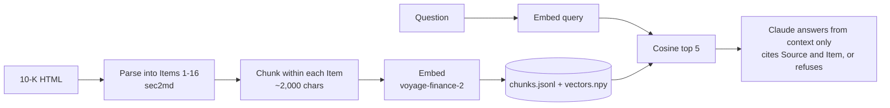

# finrag

Grounded question answering over SEC 10-K filings, built from scratch with the evaluation harness first.

Ask a question about a company's annual report and finrag answers only from the filing, cites the section it used, and says so plainly when the filing doesn't contain the answer.

```
$ python3 ask.py "How much did Apple spend on share repurchases in fiscal 2025?"
...answer with citations like (Source 2, Item 7)...
```

## Why build it by hand

Frameworks hide exactly the parts that break when you deploy RAG for a real customer: parsing messy documents, chunking, and knowing whether a change made things better or worse. I wanted to own and defend every decision, so finrag uses libraries only for commodity pieces (the embedding API, and a parser chosen after a bake-off) and builds the rest by hand.

## How it works



| Stage | What it does | Why |
| --- | --- | --- |
| Parse | sec2md splits the filing into all 16 Items, keeps tables as Markdown and strips page footers | Chosen after a bake-off on Apple, Microsoft and JPMorgan filings; my first regex parser silently mislabeled Items 9B–16 |
| Chunk | Greedy packing of paragraphs into ~2,000-character chunks that never cross an Item boundary; oversized paragraphs split by sentence | Keeps each chunk on one topic and every citation accurate |
| Embed | voyage-finance-2 (1,024 dimensions), with separate document and query input types | Finance-tuned model; asymmetric retrieval |
| Retrieve | Brute-force cosine similarity over normalized vectors, top 5 | 128 chunks: exact, instant, no infrastructure. The swap to a vector database sits behind one `search()` function |
| Generate | Claude answers only from the retrieved context, cites `(Source N, Item X)`, and refuses when the context doesn't contain the answer | Grounding and honest refusals matter more than fluency in finance |

## Results

Baseline at commit `8f569f9`, on a 37-question golden set (30 answerable, 7 unanswerable traps):

| Metric | Score | What it measures |
| --- | --- | --- |
| Recall@5 | 0.93 | Did any of the top 5 chunks come from the right Item? |
| MRR | 0.92 | How high the first correct chunk ranks |
| Answerable accuracy | 0.88 | Correct answers, graded by an LLM judge |
| Refusal accuracy | 1.00 | Correct refusals on questions the filing can't answer |
| Faithfulness | 36 / 37 | Answers fully supported by the retrieved context |

Every evaluation run is logged to `eval/history.jsonl` with its git commit, so any score can be traced to the exact code that produced it.

## Evaluation

The harness was built before any tuning, because without a baseline every "improvement" is a guess.

- **Golden set** (`eval/golden_set.json`): each question has a type (answerable or unanswerable), the Items that contain the answer, and a reference answer checked against the filing. Later questions were drawn from randomly sampled chunks to reduce selection bias.
- **Retrieval metrics** (`python3 -m eval.recall`): recall@5 and MRR, with no LLM involved, so they're fast, cheap and deterministic.
- **LLM judge** (`python3 -m eval.score`): grades each answer CORRECT, PARTIAL or INCORRECT, and separately checks faithfulness against the retrieved context, listing any unsupported claims.

## What I learned

- **Lower but honest beats high but wrong.** When I switched parsers, recall dropped from 1.00 to 0.87. The old 1.00 was inflated: a parser bug had labeled Items 9B–16 as Item 9A, which counted wrong chunks as hits. I kept the honest number.
- **Measure every change, and revert what doesn't help.** A 300-character chunk overlap didn't fix the question it targeted and cut MRR from 0.97 to 0.92, so I reverted it.
- **The judge needs testing too.** It once marked an answer CORRECT that contained a wrong claim the reference didn't mention, and once accepted a refusal on an answerable question. Giving the judge the retrieved context and a separate faithfulness check fixed the first; a rule change fixed the second.
- **Attribute every score change.** Refusal accuracy once jumped from 0.79 to 1.00 because the grading policy changed, not because finrag improved. Code, rules and data each move scores differently.
- **Don't overfit to the test set.** I declined parser patches that would have rescued two failing questions without improving retrieval in general.

## Known limitations

- One filing (Apple FY2025) so far; ingestion is tested but not yet validated across many companies and years.
- Recall@5 is Item-level, so it can count a hit when the specific chunk with the answer wasn't retrieved. A chunk-level check is planned.
- Chunks ignore subheadings within an Item, and large tables can split across chunks.

## Roadmap

1. Reranker over the top 30 candidates, measured on and off against the baseline
2. Heading-aware chunking with a breadcrumb (company, year, Item, subheading) on each chunk
3. Hybrid search with BM25 if exact-term lookups still miss
4. MCP server and an agent layer on top of the pipeline
5. A small web UI and a public deployment

## Run it

Requires Python 3.12 and API keys for Anthropic and Voyage AI.

```bash
git clone https://github.com/praveensundaram/finrag.git
cd finrag
python3 -m venv .venv && source .venv/bin/activate
pip install -r requirements.txt
cp .env.example .env        # then add your API keys
python3 build.py            # parse, chunk and embed the filing (run once)
python3 ask.py "your question"
```

Evaluate and test:

```bash
python3 -m eval.recall      # recall@5 and MRR
python3 -m eval.score       # LLM-judged accuracy and faithfulness
python3 -m pytest tests/ -v # ingestion tests
```

## Repository layout

```
finrag/          config, clients, parse, chunk, index, retrieve, generate
build.py         builds the corpus (parse → chunk → embed)
ask.py           asks a question from the command line
eval/            golden set, recall, judge, score, history log, FINDINGS.md
tests/           ingestion tests (Items in order, chunk bounds, row alignment, no footers)
data/raw/        the source filing
```
